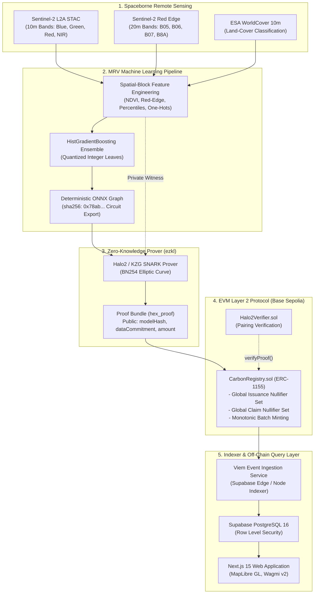
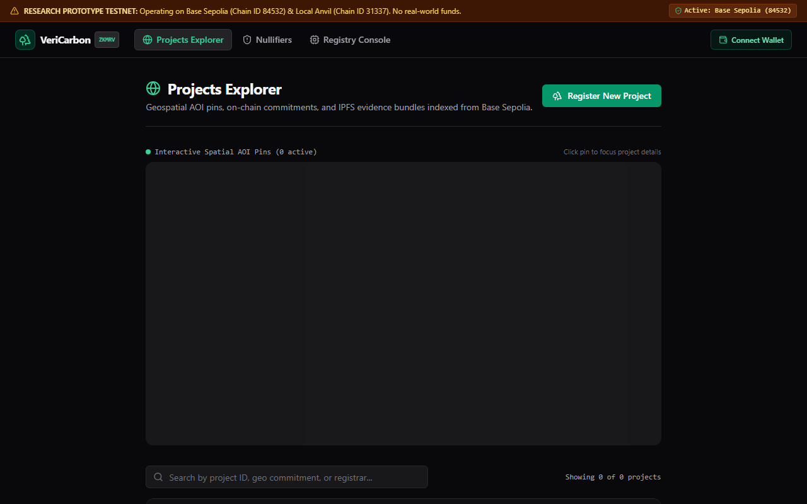
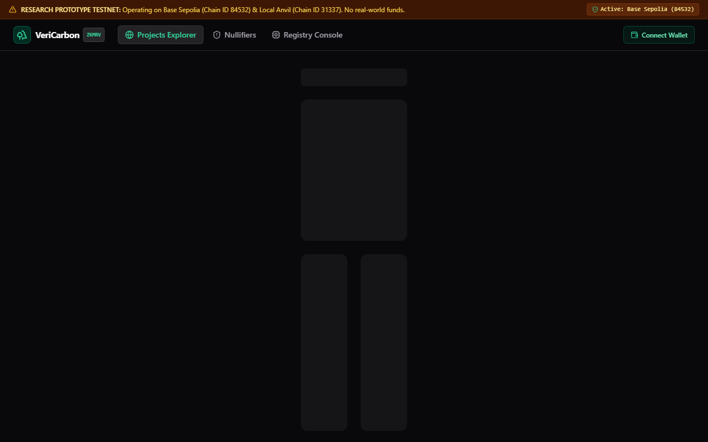
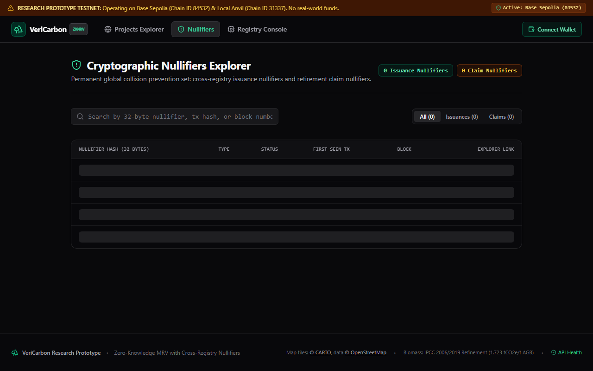

# VeriCarbon: Zero-Knowledge Verifiable Carbon MRV

VeriCarbon is a zero-knowledge verifiable Monitoring, Reporting, and Verification (MRV) protocol for voluntary and compliance carbon credit markets that pairs satellite remote sensing inference with on-chain cryptographic nullifiers.

## Problem Statement

Voluntary carbon credit markets are plagued by systematic over-crediting, cross-registry double-issuance, and fraudulent retirement claims enabled by opaque, manual verification procedures and siloed registries. Existing decentralized approaches either fail to prove that claimed credits match complex satellite-derived machine learning models or leak sensitive geographic boundaries directly on public blockchains. VeriCarbon resolves this trilemma by binding spaceborne remote sensing inference to zero-knowledge SNARKs and on-chain geospatial nullifiers on Base Sepolia, cryptographically preventing over-issuance and double claims while keeping land coordinates private.

---

## Architecture Overview



For complete technical specifications, sequence flows, and trust models, see [docs/ARCHITECTURE.md](docs/ARCHITECTURE.md).

---

## 10-Minute Quickstart

### Prerequisites
- Node.js 22+ & `pnpm` 9+
- Python 3.11+ & `uv`
- Foundry (`forge` and `anvil`)
- (Optional for ZK proving) `ezkl` CLI

### Option A: Local Evaluation (Recommended — 100% Offline & $0 Cost)

Run the full end-to-end "Day in the Life" artifact evaluation journey in a single command. This boots a local Anvil EVM node, starts an embedded PostgreSQL 16 Supabase gateway (via PGlite), deploys the protocol contracts, registers a project, mints 544 ZK-verified credits, thwarts two fraud attacks (cross-registry double issuance and duplicate retirement), syncs the off-chain indexer, and outputs a narrated summary:

```bash
# On Linux / macOS:
bash demo/day_in_the_life.sh

# On Windows (PowerShell):
powershell -ExecutionPolicy Bypass -File demo/day_in_the_life.ps1
```

To run the Next.js 15 web interface against local services:
```bash
# 1. Install workspace dependencies
pnpm install

# 2. Start local Supabase gateway (Terminal 1)
node supabase/local_server.mjs

# 3. Start local Anvil node (Terminal 2)
anvil --chain-id 31337

# 4. Start Next.js development server (Terminal 3)
pnpm --filter @vericarbon/web dev
```
Open [http://localhost:3000](http://localhost:3000) to view the Explorer and Console.

---

### Option B: Cloud Testnet (Base Sepolia + Supabase Cloud)

1. **Configure Environment Variables**:
   ```bash
   cp .env.example .env
   cp apps/web/.env.example apps/web/.env.local
   ```
   Populate your `BASE_SEPOLIA_RPC_URL`, `DEPLOYER_PRIVATE_KEY`, and `NEXT_PUBLIC_SUPABASE_URL` credentials.

2. **Deploy Smart Contracts to Base Sepolia**:
   ```bash
   cd packages/contracts
   forge script script/Deploy.s.sol --rpc-url $BASE_SEPOLIA_RPC_URL --broadcast --verify
   ```

3. **Deploy Supabase Schema & Edge Functions**:
   ```bash
   supabase db push
   supabase functions deploy indexer
   ```

4. **Launch Web Application**:
   ```bash
   pnpm --filter @vericarbon/web build
   pnpm --filter @vericarbon/web start
   ```

---

## User Interface Screenshots

All screenshots are captured directly from the live Next.js 15 application running against Base Sepolia / Anvil:

### 1. Landing Page & Live Market Architecture


### 2. MapLibre Geospatial Project Explorer


### 3. Project Details & On-Chain ZK Proof Verification


### 4. Registry Console (Gated Issuance & Geohash Pinning)


### 5. Global Cryptographic Nullifiers Explorer


---

## Empirical Research Artifacts & Paper Tables

All experimental results and benchmarks reported in the manuscript are deterministically generated by the `eval/` benchmark suite:

| Paper Evaluation Section | Description | Artifact Table / Figure Link |
| :--- | :--- | :--- |
| **Model Accuracy** | Spatial-block cross-validation (MAE, RMSE, $R^2$) on Sentinel-2 & ESA WorldCover | [paper/tables/model_metrics.md](paper/tables/model_metrics.md) |
| **ZK Prover Performance** | Halo2 prover scaling, RAM consumption, and verification times | [paper/tables/zk_benchmarks.md](paper/tables/zk_benchmarks.md) & [Figure 1](paper/figures/proving_time.png) |
| **On-Chain Gas Economics** | Execution gas vs. Centralized Baseline & USD cost on Base L2 vs. Ethereum L1 | [paper/tables/gas_costs.md](paper/tables/gas_costs.md) & [Figure 2](paper/figures/gas_comparison.png) |
| **Fraud & Security Matrix** | Empirical results against 6 attack vectors (double issuance, replay, fake proofs) | [paper/tables/fraud_results.md](paper/tables/fraud_results.md) |
| **Indexing Latency** | End-to-end event indexing lag ($n=20$, mean and $p95$) into Supabase | [paper/tables/latency.md](paper/tables/latency.md) |

To regenerate all evaluation tables and publication figures from scratch:
```bash
python eval/run_all.py
```

---

## Per-Package Run & Test Commands

| Package / Service | Tech Stack | Build Command | Test / Verification Command |
| :--- | :--- | :--- | :--- |
| **Monorepo Root** | Turborepo, pnpm | `pnpm turbo build` | `pnpm turbo test` |
| **`apps/web`** | Next.js 15, Wagmi v2, MapLibre GL | `pnpm --filter @vericarbon/web build` | `pnpm --filter @vericarbon/web test` |
| **`packages/sdk`** | TypeScript, Viem, Zod | `pnpm --filter @vericarbon/sdk build` | `pnpm --filter @vericarbon/sdk test` |
| **`packages/contracts`** | Solidity 0.8.24, Foundry | `cd packages/contracts && forge build` | `cd packages/contracts && forge test -vvv` |
| **`services/mrv`** | Python 3.11, uv, Scikit-learn, ONNX | `cd services/mrv && uv sync` | `cd services/mrv && uv run pytest` |
| **`services/zk`** | ezkl v23.0.5, Halo2, KZG, BN254 | `cd services/zk && python test_zk.py` | `cd services/zk && pytest` |
| **`supabase/`** | PostgreSQL 16, PostgREST, Deno TS | `node supabase/local_server.mjs` | `pnpm --filter @vericarbon/sdk test` |
| **`eval/`** | Matplotlib, Web3, Python 3.11 | `python eval/run_all.py` | `python eval/fraud_simulation.py` |

---

## License

MIT License. Designed and maintained for open-science reproducibility.
