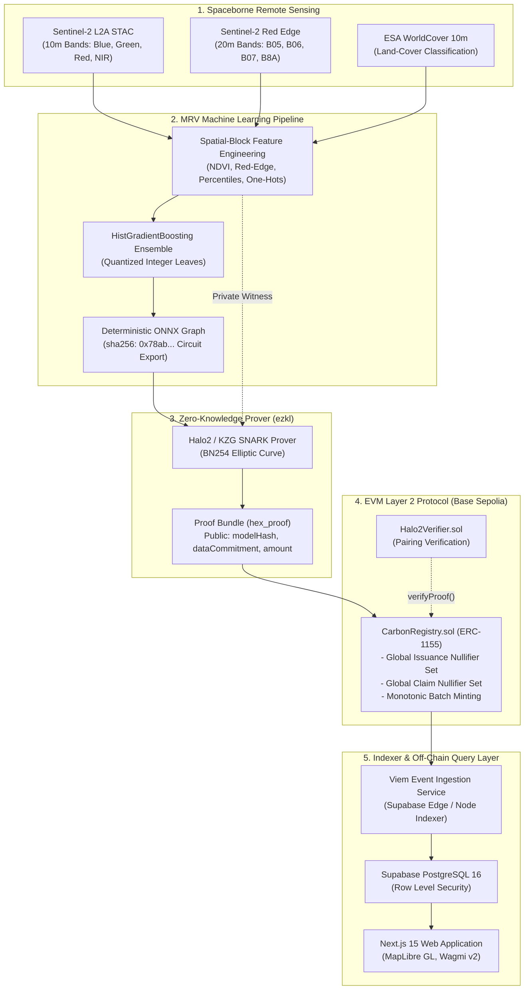

# VeriCarbon: Zero-Knowledge Verifiable Carbon MRV

[](https://github.com/samudragupto/vericarbon/actions)
[](LICENSE)
[-blue.svg)](paper/)

> [!CAUTION]
> **RESEARCH PROTOTYPE ONLY — NOT A COMMERCIAL PRODUCTION REGISTRY**
> VeriCarbon is an academic research prototype accompanying a manuscript intended for submission to *Future Generation Computer Systems* (FGCS, Elsevier). Authors: Arrhat Nag (Department of Data Science, Dr. M.G.R. Educational and Research Institute, arrhat.dsai24-1011@drmgrdu.ac.in, ORCID: 0009-0004-4328-0943), Barninee Nag (Department of Data Science, School of Sciences, JAIN (Deemed-to-be University), barninee.26014303@jainuniversity.ac.in).
> This software is strictly designed for empirical benchmarking on local testnets (Anvil `chainId: 31337`) and public testnets (Base Sepolia `chainId: 84532`). It is **NOT** a commercial carbon registry and must **NEVER** be deployed to Ethereum mainnet or used to hold real capital.

---

## The Problem Statement in Three Sentences

Voluntary carbon credit markets suffer from systemic over-crediting, cross-registry double issuance, and fraudulent retirement claims enabled by opaque, manual verification and siloed databases. Existing decentralized solutions either fail to prove that claimed credits faithfully match non-linear machine learning models over spaceborne remote sensing data, or leak sensitive geographic boundaries directly on public ledgers. VeriCarbon resolves this trilemma by coupling spaceborne remote sensing inference to Halo2/KZG zero-knowledge SNARKs and on-chain geospatial nullifiers on Base Sepolia, cryptographically guaranteeing that issuance cannot exceed model predictions and preventing cross-registry double issuance without revealing exact parcel boundaries.

---

## 100% $0 Cost Reproducibility Stack

VeriCarbon is designed for full scientific auditability and zero-cost replication:
- **Local EVM:** Foundry Anvil (`31337`) for fast local contract simulation.
- **Testnet EVM:** Base Sepolia (`84532`) via free public RPCs ($0 testnet gas).
- **Off-Chain Database:** Local Postgres-compatible double (Node.js) or Supabase Free Tier.
- **Remote Sensing:** Microsoft Planetary Computer STAC / reproducible local offline fixtures.
- **Proof Storage:** IPFS via Pinata Free Tier.

---

## Benchmark Hardware Specifications

All benchmark numbers reported in Section 6 of the manuscript were captured on the following canonical reference workstation:

- **Vendor & Model:** Lenovo LOQ 15APH8
- **Processor (CPU):** AMD Ryzen 7 7840HS (8 cores, 16 threads, 3.8 GHz base / 5.1 GHz boost)
- **System Memory (RAM):** 16.0 GB DDR5
- **Dedicated Graphics (GPU):** NVIDIA GeForce RTX 4060 Laptop GPU (8.0 GB VRAM)
  *(Listed for disclosure honesty; proving is executed entirely on CPU via `ezkl` Halo2/KZG, GPU is not used as an accelerator)*
- **Operating System:** Windows 11 Home / PowerShell 7

---

## Architecture Overview



For complete technical specifications, sequence flows, and trust assumptions, see [docs/ARCHITECTURE.md](docs/ARCHITECTURE.md).

---

## 10-Minute Quickstart

### Prerequisites
- Node.js 22+ & `pnpm` 9+
- Python 3.11+ & `uv`
- Foundry (`forge` and `anvil`)
- (Optional for ZK proving) `ezkl` CLI

### Option A: Local Evaluation (Recommended — 100% Offline & $0 Cost)

Run the end-to-end "Day in the Life" artifact evaluation journey in a single command. This boots local Anvil, starts an embedded local database gateway, deploys the protocol contracts, registers a project, mints 544 ZK-verified credits, halts two fraud vectors (cross-registry double issuance and duplicate retirement), syncs the off-chain indexer, and outputs a narrated summary:

```bash
# On Linux / macOS:
bash demo/day_in_the_life.sh

# On Windows (PowerShell):
powershell -ExecutionPolicy Bypass -File demo/day_in_the_life.ps1
```

To run the Next.js 15 web interface against local services:
```bash
# 1. Install workspace dependencies
pnpm install

# 2. Start local Supabase gateway (Terminal 1)
node supabase/local_server.mjs

# 3. Start local Anvil node (Terminal 2)
anvil --chain-id 31337

# 4. Start Next.js development server (Terminal 3)
pnpm --filter @vericarbon/web dev
```
Open [http://localhost:3000](http://localhost:3000) to view the Explorer and Console.

---

### Option B: Cloud Testnet (Base Sepolia + Supabase Cloud)

See [docs/DEPLOY.md](docs/DEPLOY.md) for full instructions on configuring Base Sepolia testnet contracts, Supabase free tier database migrations, Pinata IPFS keys, and Vercel hosting.

---

## User Interface Screenshots

All screenshots are captured directly from the Next.js 15 application running against Base Sepolia / Anvil:

| 1. Landing Page | 2. Geospatial Project Explorer |
| :---: | :---: |
|  |  |
| **3. Project Details & ZK Proof Verification** | **4. Registry Console** |
|  |  |
| **5. Nullifiers Explorer** | |
|  | |

---

## Empirical Research Artifacts & Paper Tables

All experimental results reported in the manuscript are deterministically generated by the `eval/` benchmark suite:

| Paper Evaluation Section | Description | Artifact Table / Figure Link |
| :--- | :--- | :--- |
| **Model Accuracy** | Spatial-block cross-validation (MAE, RMSE, $R^2$) on Sentinel-2 & ESA WorldCover | [paper/tables/model_metrics.md](paper/tables/model_metrics.md) |
| **ZK Prover Performance** | Halo2 prover scaling, RAM consumption, and verification times | [paper/tables/zk_benchmarks.md](paper/tables/zk_benchmarks.md) & [Figure 1](paper/figures/proving_time.png) |
| **On-Chain Gas Economics** | Execution gas vs. Centralized Baseline & USD cost on Base L2 vs. Ethereum L1 | [paper/tables/gas_costs.md](paper/tables/gas_costs.md) & [Figure 2](paper/figures/gas_comparison.png) |
| **Fraud & Security Matrix** | Empirical results against post-A0 attack vectors (A1–A7) and pre-A0 baseline vulnerabilities | [paper/tables/fraud_results.md](paper/tables/fraud_results.md) |
| **Indexing Latency** | End-to-end event indexing lag ($n=20$, mean and $p95$) into Supabase | [paper/tables/latency.md](paper/tables/latency.md) |

To regenerate all evaluation tables and publication figures from scratch:
```bash
uv run eval/run_all.py
```

---

## Per-Package Run & Test Commands

| Package / Service | Tech Stack | Build Command | Test / Verification Command |
| :--- | :--- | :--- | :--- |
| **Monorepo Root** | Turborepo, pnpm | `pnpm turbo build` | `pnpm turbo test` |
| **`apps/web`** | Next.js 15, Wagmi v2, MapLibre GL | `pnpm --filter @vericarbon/web build` | `pnpm --filter @vericarbon/web test` |
| **`packages/sdk`** | TypeScript, Viem, Zod | `pnpm --filter @vericarbon/sdk build` | `pnpm --filter @vericarbon/sdk test` |
| **`packages/contracts`** | Solidity 0.8.24, Foundry | `cd packages/contracts && forge build` | `cd packages/contracts && forge test -vvv` |
| **`services/mrv`** | Python 3.11, uv, Scikit-learn, ONNX | `cd services/mrv && uv sync` | `cd services/mrv && uv run pytest` |
| **`services/zk`** | ezkl v23.0.5, Halo2, KZG, BN254 | `cd services/zk && python test_zk.py` | `cd services/zk && pytest` |
| **`supabase/`** | PostgreSQL 16, PostgREST, Deno TS | `node supabase/local_server.mjs` | `pnpm --filter @vericarbon/sdk test` |
| **`eval/`** | Matplotlib, Web3, Python 3.11 | `uv run eval/run_all.py` | `uv run python eval/fraud_simulation.py` |

---

## Statement on AI Assistance

In accordance with scholarly reporting and ethics standards: Generative AI coding assistants were utilized during project development for boilerplate scaffolding, test suite generation, and documentation drafting under strict human direction, continuous verification, deterministic unit testing, and rigorous automated self-auditing scripts.

---

## License

MIT License. Designed and maintained for open-science reproducibility. See [LICENSE](LICENSE).
