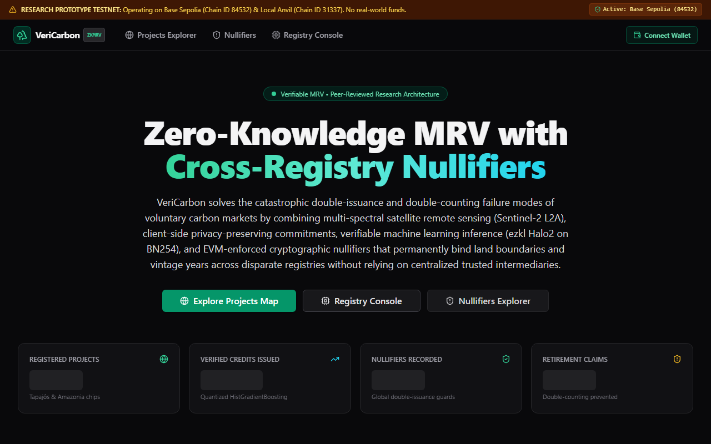
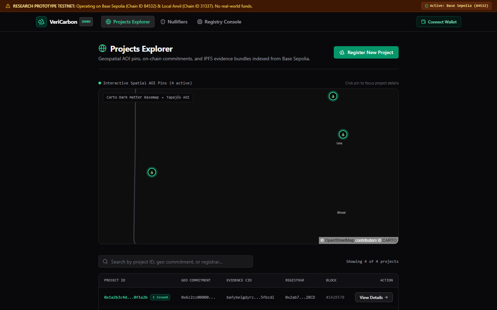
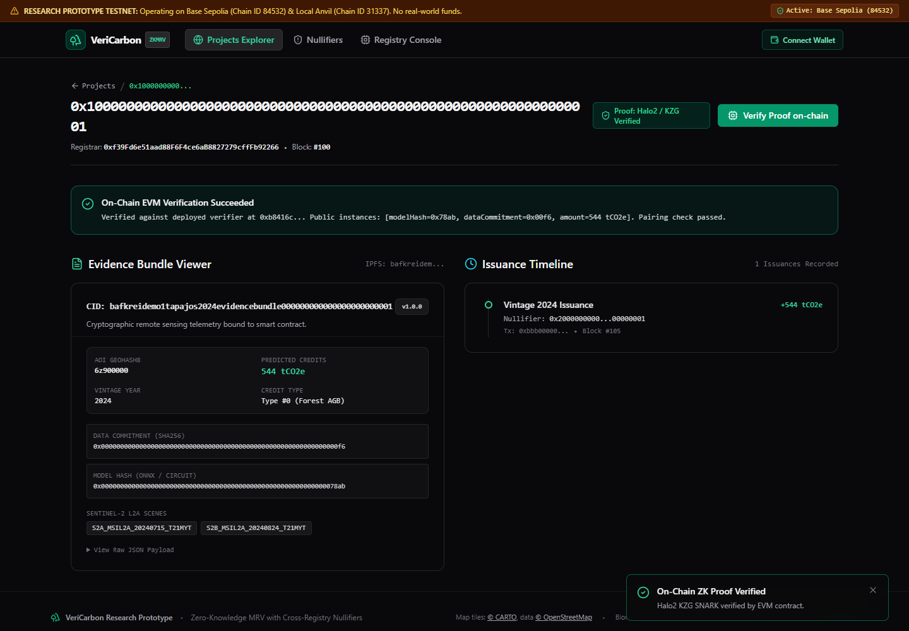
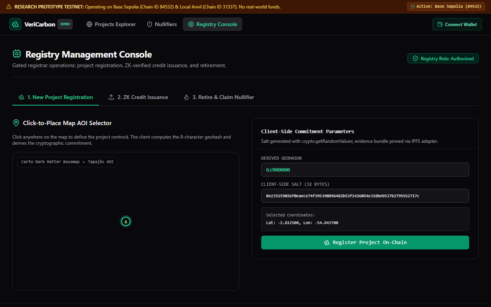
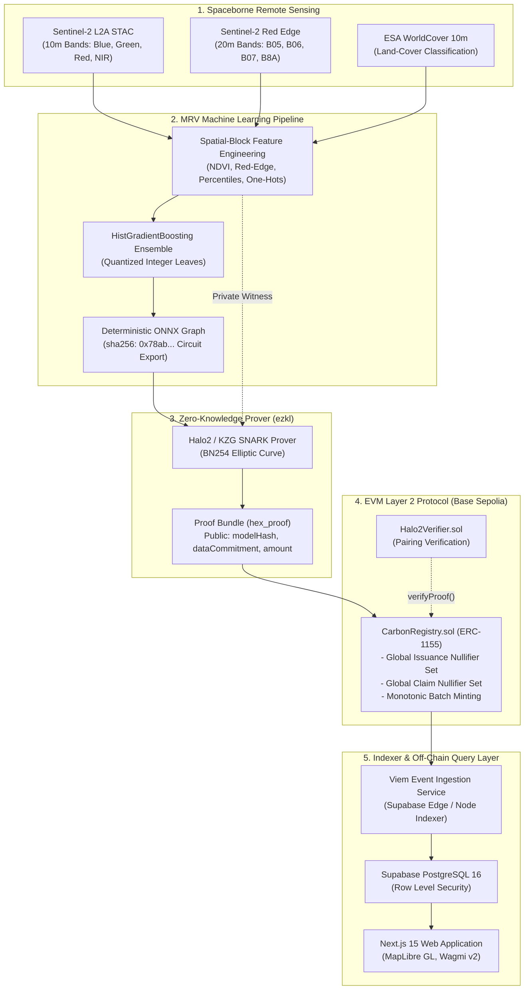
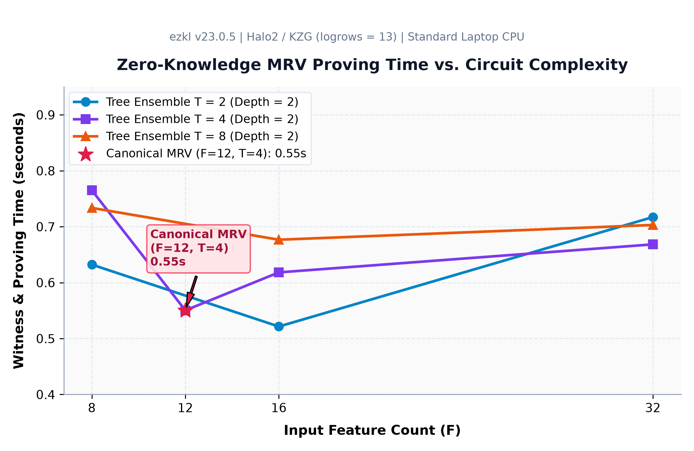
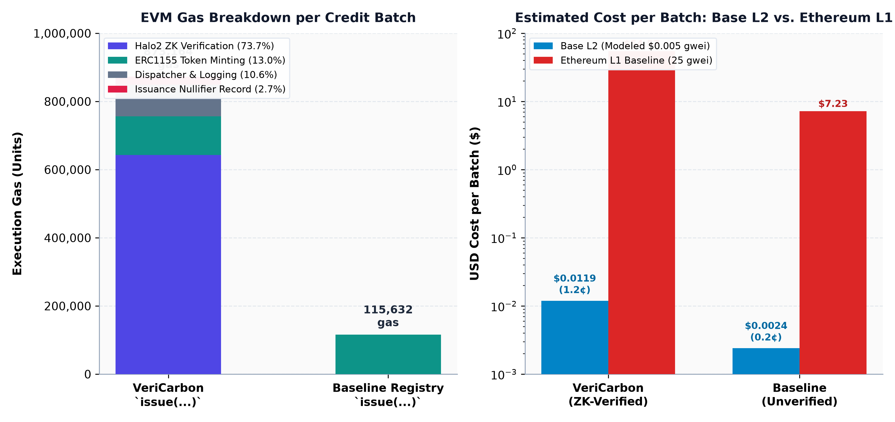

# VeriCarbon: Zero-Knowledge Verifiable Carbon MRV

[](https://github.com/samudragupto/vericarbon/actions/workflows/ci.yml)
[](LICENSE)
[-0052FF.svg)](https://sepolia.basescan.org)

> [!CAUTION]
> **RESEARCH PROTOTYPE ONLY — NOT A COMMERCIAL PRODUCTION REGISTRY**  
> VeriCarbon is an academic research prototype accompanying a research manuscript.  
> **Authors:**
> - **Arrhat Nag** (Department of Data Science, Dr. M.G.R. Educational and Research Institute, `arrhat.dsai24-1011@drmgrdu.ac.in`, ORCID: [0009-0004-4328-0943](https://orcid.org/0009-0004-4328-0943))
> - **Barninee Nag** (Department of Data Science, School of Sciences, JAIN (Deemed-to-be University), `barninee.26014303@jainuniversity.ac.in`, ORCID: [0009-0008-2208-9989](https://orcid.org/0009-0008-2208-9989))  
> 
> This software is strictly designed for empirical benchmarking on local testnets (Anvil `chainId: 31337`) and public L2 testnets (Base Sepolia `chainId: 84532`). It is **NOT** a commercial carbon registry and must **NEVER** be deployed to Ethereum mainnet or used to hold real capital. AGB labels in the evaluation fixture are synthesized (SEED=42); reported metrics are fixture self-consistency.

> [!NOTE]
> **Cloud Deployment & Cold-Start Latency Notice:**  
> When accessing the live prototype hosted on the **$0 free-tier cloud stack** (Vercel Serverless + Supabase Free Tier), the initial page load may require **15–25 seconds** while serverless edge containers and the idle database spin up from a cold start. Subsequent navigation is cached and fast. Additionally, the web client displays a persistent status banner (`Cached demo data — live sync in progress`) whenever fallback is active, rendering the reproducible fixture dataset from `services/mrv/tests/fixtures/`.

---

## Live Smart Contracts (Base Sepolia Testnet)

The core protocol smart contracts are live on **Base Sepolia (Chain ID `84532`)**:

| Contract Component | Deployed Address | Address on Basescan |
| :--- | :--- | :--- |
| **`CarbonRegistry`** (ERC-1155 Spatial Nullifiers) | `0x2ab745F51002Ce236A9A2dA81cDaA553B87f28CD` | [View on Basescan](https://sepolia.basescan.org/address/0x2ab745F51002Ce236A9A2dA81cDaA553B87f28CD) |
| **`Halo2Verifier`** (Zero-Knowledge Verifier) | `0xb8416cb4d82BA72b70C3EC55d7AC66b5DB415CF8` | [View on Basescan](https://sepolia.basescan.org/address/0xb8416cb4d82BA72b70C3EC55d7AC66b5DB415CF8) |
| **`BaselineCentralRegistry`** (Benchmark Comparison) | `0xfeBEf266291E7994cC7724023C1442be83D010b1` | [View on Basescan](https://sepolia.basescan.org/address/0xfeBEf266291E7994cC7724023C1442be83D010b1) |
| **Deployer Wallet** | `0xb491fe5846DE735B6Cb03a677A3C6296FAB0aDA5` | [View Transactions](https://sepolia.basescan.org/address/0xb491fe5846DE735B6Cb03a677A3C6296FAB0aDA5) |

---

## The Problem Statement in Three Sentences

Voluntary carbon credit markets suffer from systemic over-crediting, cross-registry double issuance, and fraudulent retirement claims enabled by opaque, manual verification and siloed databases. Existing decentralized solutions either fail to prove that claimed credits faithfully match non-linear machine learning models over spaceborne remote sensing data, or leak sensitive geographic boundaries directly on public ledgers. VeriCarbon resolves this trilemma by coupling spaceborne remote sensing inference to Halo2/KZG zero-knowledge SNARKs and on-chain geospatial nullifiers on Base Sepolia, so that any second issuance of the same (geohash8 cell, vintage year, credit type) reverts across deployments of this contract on the same L2, claimed issuance is bounded by the committed model's output, and parcel boundaries stay off-chain.

---

## User Interface & Application Walkthrough

The VeriCarbon user interface is built on Next.js 15, Wagmi v2, Viem, and MapLibre GL. It enables carbon project developers, verifiers, and buyers to inspect geospatial projects, verify cryptographic proofs, and mint tokens.

### 1. Interactive Landing & Protocol Overview
Overview of the VeriCarbon cryptographic verification pipeline, protocol architecture, and live network metrics.


### 2. Geospatial Projects Explorer
Spatial visualization of project Areas of Interest (AOIs) mapped over the Tapajós National Forest, Pará, Brazil, featuring real-time geohash boundary decoders and IPFS evidence bundle links.


### 3. Project Details & Zero-Knowledge Verification
Deep inspection of project commitments, Sentinel-2 spectral indices, ESA WorldCover land-classification inputs, and browser-executed verification of the Halo2 BN254 proof bundle.


### 4. Gated Registry Console
Interactive map coordinate picker, Geohash-8 calculator, client-side salt generation, and MetaMask-gated credit issuance pipeline with proof submission.


### 5. Global Cryptographic Nullifiers Explorer
Public on-chain ledger auditing all spent issuance and retirement nullifiers, ensuring duplicate minting or double claiming reverts on-chain.


---

## System Architecture



For complete technical specifications, mathematical proofs, and threat models, see [docs/ARCHITECTURE.md](docs/ARCHITECTURE.md).

---

## Empirical Research Artifacts & Benchmarks

All benchmark figures and tables reported in Section 6 of the manuscript are generated by the automated evaluation harness:

<div align="center">
  
  
</div>

| Manuscript Evaluation Section | Description | Artifact Table / Figure Link |
| :--- | :--- | :--- |
| **Pipeline validation (§6.1)** | Spatial-block cross-validation (MAE, RMSE, $R^2$) on Sentinel-2 & WorldCover (synthesized fixture labels — self-consistency, not field accuracy) | [paper/tables/model_metrics.md](paper/tables/model_metrics.md) |
| **ZK Prover Performance (§6.2)** | Halo2 prover scaling, proving time, and verification gas across model topologies | [paper/tables/zk_benchmarks.md](paper/tables/zk_benchmarks.md) & [Figure 1](docs/screenshots/proving_time.png) |
| **Fraud & Security Matrix (§6.3)** | Verification against post-A0 attack vectors (A1–A7) and pre-A0 baseline vulnerabilities | [paper/tables/fraud_results.md](paper/tables/fraud_results.md) |
| **On-Chain Gas & Indexing Overhead (§6.4)** | Execution gas vs. Centralized Baseline, Base L2 USD economics, and event indexing latency ($n=20$, mean and $p95$) | [paper/tables/gas_costs.md](paper/tables/gas_costs.md), [paper/tables/latency.md](paper/tables/latency.md) & [Figure 2](docs/screenshots/gas_comparison.png) |
| **Privacy–auditability trade-off (§6.5, qualitative)** | Qualitative analysis of off-chain imagery retention, on-chain SHA-256 audit commitments, and ezkl field bindings | [docs/ARCHITECTURE.md](docs/ARCHITECTURE.md#security-and-threat-model) |

To regenerate all evaluation tables and publication figures from raw data:
```bash
uv run eval/run_all.py
```

---

## Canonical Hardware Specifications

All benchmark numbers reported in Section 6 of the manuscript were captured on the canonical reference workstation:

- **Vendor & Model:** Lenovo LOQ 15APH8
- **Processor (CPU):** AMD Ryzen 7 7840HS (8 physical cores, 16 logical threads, 3.8 GHz base / 5.1 GHz boost)
- **System Memory (RAM):** 16.0 GB DDR5
- **Dedicated Graphics (GPU):** NVIDIA GeForce RTX 4060 Laptop GPU (8.0 GB VRAM)  
  *(Listed for disclosure honesty; proving is executed entirely on CPU via `ezkl` Halo2/KZG, GPU is not used as an accelerator)*
- **Operating System:** Windows 11 Home / PowerShell 7

---

## 100% $0 Cost Reproducibility Stack

VeriCarbon is designed for zero-cost replication by independent reviewers:
- **Local EVM:** Foundry Anvil (`31337`) for zero-cost, instantaneous local contract simulation.
- **Testnet EVM:** Base Sepolia (`84532`) via free public RPCs ($0 testnet gas).
- **Off-Chain Database:** Local Postgres double (`node supabase/local_server.mjs`) or Supabase Free Tier.
- **Remote Sensing:** Microsoft Planetary Computer STAC / offline synthetic fixture datasets.
- **Proof Storage:** IPFS via Pinata Free Tier.

---

## Quickstart Guide

### Prerequisites
- Node.js 22+ & `pnpm` 9+
- Python 3.11+ & `uv`
- Foundry (`forge` and `anvil`)
- (Optional for ZK proving) `ezkl` CLI

### Option A: Local Evaluation (Recommended — 100% Offline & $0 Cost)

Run the end-to-end automated artifact evaluation journey in a single command. This boots local Anvil, starts an embedded local database gateway, deploys protocol contracts, registers a project, mints 544 ZK-verified credits, halts two fraud vectors (cross-registry double issuance and duplicate retirement), syncs the off-chain indexer, and outputs a narrated summary:

```bash
# On Linux / macOS:
bash demo/day_in_the_life.sh

# On Windows (PowerShell):
powershell -ExecutionPolicy Bypass -File demo/day_in_the_life.ps1
```

To run the Next.js 15 web interface against local services:
```bash
# 1. Install workspace dependencies
pnpm install

# 2. Start local Supabase gateway (Terminal 1)
node supabase/local_server.mjs

# 3. Start local Anvil node (Terminal 2)
anvil --chain-id 31337

# 4. Start Next.js development server (Terminal 3)
pnpm --filter @vericarbon/web dev
```
Open [http://localhost:3000](http://localhost:3000) to view the Explorer and Console.

---

### Option B: Cloud Testnet (Base Sepolia + Supabase Cloud)

See [docs/DEPLOY.md](docs/DEPLOY.md) for full instructions on configuring Base Sepolia testnet contracts, Supabase free-tier database migrations, Pinata IPFS keys, and Vercel hosting.

---

## Per-Package Run & Test Commands

| Package / Service | Tech Stack | Build Command | Test / Verification Command |
| :--- | :--- | :--- | :--- |
| **Monorepo Root** | Turborepo, pnpm | `pnpm turbo build` | `pnpm turbo test` |
| **`apps/web`** | Next.js 15, Wagmi v2, MapLibre GL | `pnpm --filter @vericarbon/web build` | `pnpm --filter @vericarbon/web test` |
| **`packages/sdk`** | TypeScript, Viem, Zod | `pnpm --filter @vericarbon/sdk build` | `pnpm --filter @vericarbon/sdk test` |
| **`packages/contracts`** | Solidity 0.8.24, Foundry | `cd packages/contracts && forge build` | `cd packages/contracts && forge test -vvv` |
| **`services/mrv`** | Python 3.11, uv, Scikit-learn, ONNX | `cd services/mrv && uv sync` | `cd services/mrv && uv run pytest` |
| **`services/zk`** | ezkl v23.0.5, Halo2, KZG, BN254 | `cd services/zk && python test_zk.py` | `cd services/zk && pytest` |
| **`supabase/`** | PostgreSQL 16, PostgREST, Deno TS | `node supabase/local_server.mjs` | `pnpm --filter @vericarbon/sdk test` |
| **`eval/`** | Matplotlib, Web3, Python 3.11 | `uv run eval/run_all.py` | `uv run python eval/fraud_simulation.py` |

---

## Statement on AI Assistance

In accordance with scholarly reporting and ethics standards: Generative AI coding assistants were utilized during project development for boilerplate scaffolding, test suite generation, and documentation drafting under strict human direction, continuous verification, deterministic unit testing, and rigorous automated self-auditing scripts.

---

## License

MIT License. Designed and maintained for open-science reproducibility. See [LICENSE](LICENSE).
