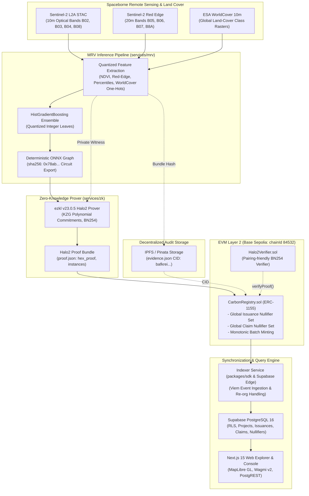
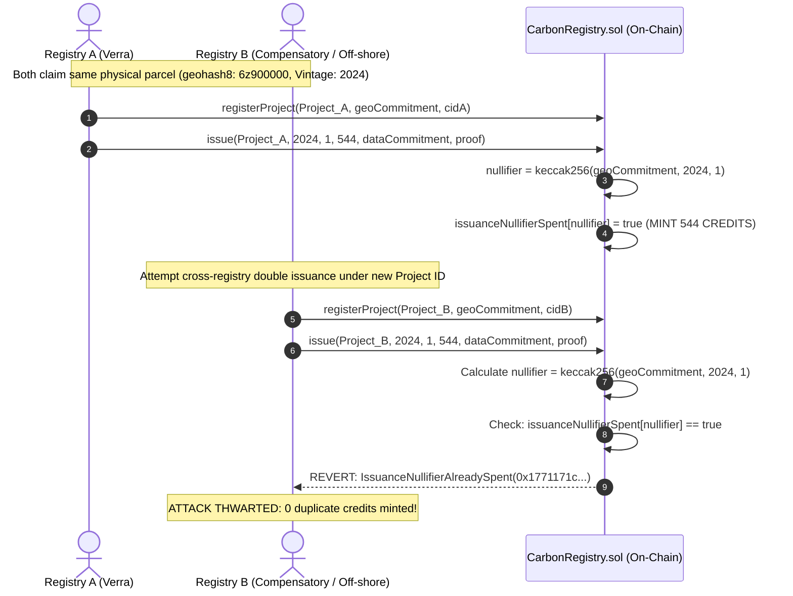

# VeriCarbon Architecture Specification

VeriCarbon is a zero-knowledge verifiable Monitoring, Reporting, and Verification (MRV) architecture for voluntary and compliance carbon credit markets. It pairs satellite-derived biomass inference (Sentinel-2 L2A and ESA WorldCover processed into an ONNX ensemble proved via Halo2/KZG zero-knowledge circuits) with on-chain cross-registry geospatial issuance and claim nullifiers on EVM networks (Base Sepolia / Ethereum L1) to cryptographically eliminate over-crediting, cross-registry double issuance, and duplicate claiming without disclosing private land boundaries.

---

## 1. System Component Architecture



---

## 2. Core Protocol Data Flows

### (a) Verifiable Issuance with Zero-Knowledge Proof

```mermaid
sequenceDiagram
    autonumber
    actor ProjectDev as Project Developer
    participant MRV as services/mrv
    participant ZK as services/zk (ezkl)
    participant IPFS as IPFS / Pinata
    participant Registry as CarbonRegistry.sol
    participant Verifier as Halo2Verifier.sol
    participant Indexer as Supabase Indexer

    ProjectDev->>MRV: mrv quantify --aoi geojson --vintage 2024
    MRV->>MRV: Compute 12 quantized features (NDVI, Red-Edge, LandCover)
    MRV->>MRV: Model inference: y_pred = 544.75 tCO2e (claimed: 544)
    MRV->>ZK: zk prove --bundle evidence.json
    ZK->>ZK: Halo2 proof generation over BN254 curve (11.5s Laptop CPU)
    ZK-->>ProjectDev: proof.json (hex_proof, instances: [modelHash, dataCommitment, 544])
    ProjectDev->>IPFS: Upload evidence.json -> CID bafkreie2e...
    ProjectDev->>Registry: registerProject(projectId, geoCommitment, evidenceCid)
    Registry-->>Registry: Store project details; emit ProjectRegistered
    ProjectDev->>Registry: issue(projectId, vintage=2024, type=1, amount=544, dataCommitment, proof)
    Registry->>Verifier: verifyProof(proof, instances)
    Verifier-->>Registry: true (Cryptographically valid)
    Registry->>Registry: issuanceNullifier = keccak256(geoCommitment, vintage, type)
    Registry->>Registry: require(!issuanceNullifierSpent[nullifier])
    Registry->>Registry: issuanceNullifierSpent[nullifier] = true
    Registry->>Registry: _mint(recipient, serialId=1, amount=544)
    Registry-->>Registry: emit Issued(nullifier, projectId, 544, 2024, 1, evidenceCid)
    Registry-->>Indexer: Block mined on Base Sepolia
    Indexer->>Indexer: Upsert issuance & nullifier into Supabase
```

---

### (b) Cross-Registry Double-Issuance Attack & Interception

A foundational failure of centralized, isolated carbon registries (e.g., Verra, Gold Standard, ACR) is that a land steward or corrupt intermediary can submit the same forest plot to multiple registries simultaneously. Because separate registries maintain isolated databases without shared state, both registries issue credits for the same trees and vintage year.

In VeriCarbon, the `issuanceNullifier` formula deliberately **excludes** the `registryAddress` and `projectId`:

$$\text{issuanceNullifier} = \text{keccak256}(\text{geoCommitment} \parallel \text{vintageYear} \parallel \text{creditType})$$

where:

$$\text{geoCommitment} = \text{keccak256}(\text{geohash8} \parallel \text{salt})$$



---

### (c) Off-Chain Event Indexing & Query Architecture

The off-chain ingestion pipeline provides low-latency queryability while maintaining on-chain authority:

1. **Chain Polling with Re-org Window**: The indexer queries `getLogs` from `sync_log.last_block + 1` up to `latest - CONFIRMATIONS`.
2. **Log Decoders**: Events parsed using `viem/abi` definitions for `ProjectRegistered`, `Issued`, and `Claimed`.
3. **Atomic Upsert**: Database writes occur in idempotent PostgreSQL transactions:
   - `projects`: Primary key `project_id`.
   - `issuances`: Primary key `issuance_nullifier`.
   - `claims`: Primary key `claim_nullifier`.
   - `nullifiers`: Primary key `nullifier` with constraint `kind IN ('issuance', 'claim')`.
   - `sync_log`: Updates `last_block` monotonically.
4. **Fallback Resilience**: If Supabase PostgREST is unreachable or degraded, the client web explorer automatically falls back to direct Base Sepolia JSON-RPC calls via `wagmi` and `viem`.

---

## 3. Trust Assumptions and Threat Model

To provide rigorous academic evaluation, we explicitly articulate what VeriCarbon **does** and **does NOT** defend against. Acknowledging architectural boundaries strengthens the protocol's guarantees.

### What VeriCarbon Cryptographically Defends Against:
1. **Model Parameter Tampering (Over-crediting)**: A dishonest registry cannot use an inflated model to issue more credits than authorized. The on-chain verifier binds `CIRCUIT_MODEL_HASH = sha256(onnx_graph)`, and the Halo2 SNARK guarantees $amount \le f_{model}(X)$.
2. **Cross-Registry Double Issuance**: Because nullifiers omit registry identity, duplicate submissions across arbitrary registries collide on `issuanceNullifier` and revert.
3. **Double Claiming / Replay of Corporate Retirements**: `claimNullifier = keccak256(issuanceNullifier, claimant, claimType, beneficiaryCommitment)` guarantees that a retired credit batch cannot be re-retired or assigned to multiple corporate beneficiaries.
4. **Land Boundary Surveillance**: Raw geohash centroids and bounding boxes are never published in plaintext on-chain. Only the salted commitment $\text{keccak256}(\text{geohash8} \parallel \text{salt})$ is public.

### Explicit Limitations & What the System Does NOT Defend Against:

> [!WARNING]
> VeriCarbon secures the computation and state transitions on-chain; it does not solve physical-layer oracle spoofing or unmodeled ecological shifts.

1. **Satellite Sensor Spoofing & Upstream Telemetry Tampering**:
   - *Limitation*: If an adversary compromises the raw Sentinel-2 L2A data feed or tampers with the ESA WorldCover raster tiles prior to pipeline ingestion, the ZK proof will faithfully prove correct computation over corrupted inputs (Garbage In, Garbage Out).
   - *Mitigation*: Future work must integrate cryptographically signed hardware telemetry from satellite constellations or multi-constellation consensus (e.g. cross-verifying Sentinel-2 optical data against Landsat-9, PlanetScope, and GEDI spaceborne LiDAR).

2. **Boundary Discrepancies Below Coordinate Quantization Thresholds**:
   - *Limitation*: Geospatial commitments are anchored to discrete geohash strings (geohash-8, ~38.2m × 19.1m). If an adversary creates an overlapping polygon that deliberately shifts boundaries to fall into adjacent geohash cells without intersecting the committed centroids, the nullifiers will not collide.
   - *Mitigation*: Full polygon geometric intersection proofs in zero-knowledge (e.g., spatial R-tree intersection circuits or raster intersection bitmasks) are required for arbitrary polygon overlaps.

3. **Ecological Distribution Shift & Model Epistemic Uncertainty**:
   - *Limitation*: The HistGradientBoosting model trained on localized Brazilian Amazon ecosystems (Tapajós National Forest) possesses epistemic limits. Applying the same ONNX model to boreal forests, mangrove ecosystems, or savannas will yield erroneous biomass estimates. The zero-knowledge proof verifies arithmetic correctness of decision trees, NOT ecological validity across uncalibrated biomes.
   - *Mitigation*: Biome-specific model registrations where `modelHash` is strictly bound to standardized FAO ecological zones.

4. **Registry Private Key Compromise**:
   - *Limitation*: If an actor holding `REGISTRY_ROLE` loses their private key, the attacker can submit projects and issue credits up to valid ZK proofs.
   - *Mitigation*: VeriCarbon supports OpenZeppelin `AccessControlDefaultAdminRules` with multisig governance (Gnosis Safe), 48-hour timelocks for role assignment, and circuit-breaker pause mechanisms.

5. **Off-Chain Bilateral Misrepresentation**:
   - *Limitation*: While the on-chain `claimNullifier` guarantees that credit batch $S$ cannot be retired twice on Base Sepolia, a rogue corporate entity could present off-chain PDF certificates to ESG auditors who fail to independently query the on-chain nullifier database.
   - *Mitigation*: Standards bodies must enforce automated API querying of the public nullifier endpoint for ESG compliance verification.
